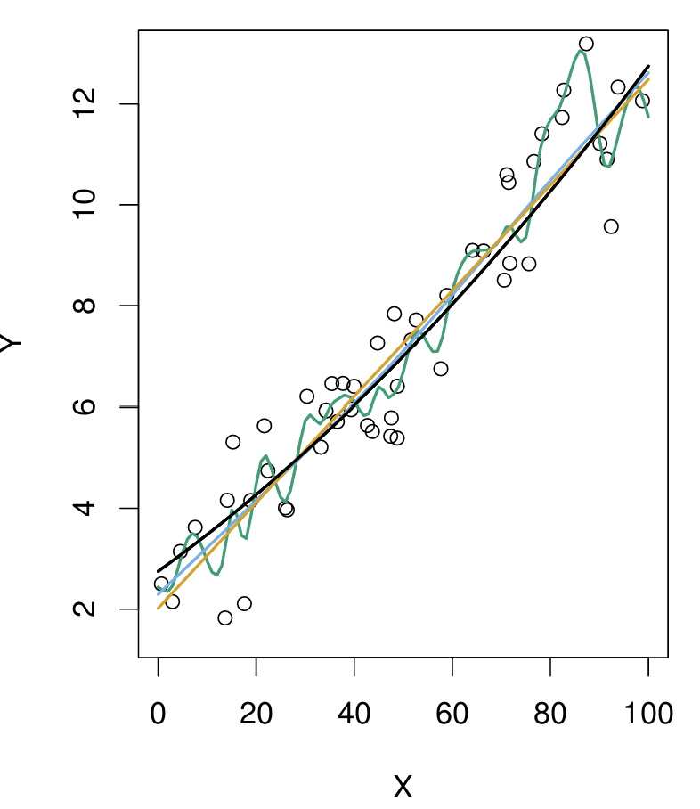
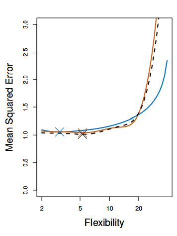
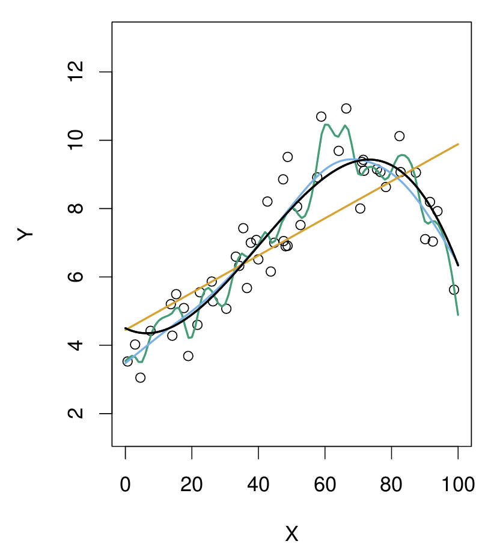
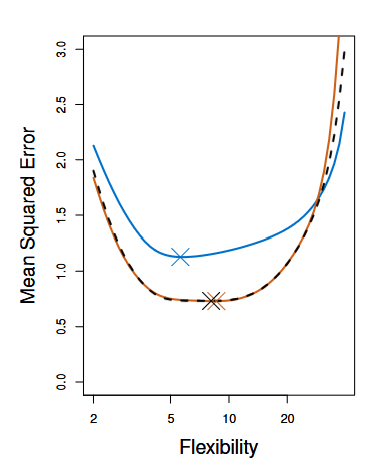

## Section 5.1

1. The Validation Set Approach
2. Leave-One-Out Cross-Validation (LOOCV)
3. k-Fold Cross-Validation (k-fold CV)
4. Bias-Variance Trade-Off for k-fold Cross-Validation
5. Cross-Validation on Classification Problems

:::{.notes}
Hello, today we will be talking about chapter 5.1, which is about cross-validation methods. I'll be going over the validation set approach, leave-one-out cross-validation, k-fold cross-validation. After, Shrey will follow up with bias-variance trade-off in k-fold cross-validation, cross-validation on classification problems, and the worksheet.
:::

## The Problem

- From previous chapters, we learned how to fit linear and logistic regression models to training data and methods to select an appropriate model
- Minimizing the training error rate does not mean the model will perform well against new data
- Cross validation: hold out a part of the training data as a validation set
  - Use MSE to quantify how well the model generalizes to new data
  - Compare models 

:::{.notes}
From previous sections, we learned how to fit linear and logistic regression models to training data and methods to select an appropriate model. In particular, we looked at things like reducing the mean squared error, or the difference between the observations in the training data and the predictions made by the model and increasing adjusted R^2 to capture as much variance in the data without overfitting. In doing so, we've minimized the error in our training dataset. However, this does not mean the model will perform well in new situations. When fitting the model, we have full access to the data, we can tweak our model to get the best metrics (adjusted R^2, AIC, BIC, MSE, etc.). However, we would not know how the model could perform against new data, which the model hasn't accounted for. Can the model capture the true trends in a data-generating process, or is it just optimized solely for the training data? Before we deploy a model in real life, it would help to have a test set available. If one is not available, we can create one by holding out a part of the training data to use as a validation set--that's the essence of cross-validation.
:::

## Example Set-Up {style="font-size: 0.7em;"}

:::{.columns}
:::{.column width="50%"}
- `Auto` dataset in `ISLR` library: gas mileage, horsepower, and 7 other variables for 392 vehicles.
- Response variable: miles per gallon (mpg)
- Predictor: engine horsepower
- Focus on minimizing the test error, or $MSE: \sum_{i=1}^{n} (y_i - \hat{y}_i)^2$
- Models:

1. $y = \beta_0 + \beta_1x + \epsilon$
2. $y = \beta_0 + \beta_1 x + \beta_2 x^2 + \epsilon$
$\vdots$
10. $y = \beta_0 + \beta_1 x + \beta_2 x^2 + ... + \beta_{10} x^{10} + \epsilon$
:::
:::{.column width = "50%"}
:::{.centre}
{fig-alt="Auto dataset" width="80%"}
:::
:::
:::

:::{.notes}
In the following methods and examples, we're using the Auto dataset from the ISLR library. This dataset tracks 9 different variables for 392 vehicles. For simplicity, we're only focusing on miles per gallon, which is the response variable, and horsepower, which is the predictor. As the dataset is nonlinear, we'll also be looking at models which include all polynomial terms up to degree 10.
:::

## Validation Set Approach {style="font-size: 0.8em;"}

- One-time process where we divide the available dataset into two parts:
  - Training set
  - Validation set or Hold-out set
- The percentage of data to allocate for training versus validation sets can vary

:::{.centre}
{fig-alt="Validation Set Schematic" width="80%"}
:::

:::{.notes}
In the validation set approach, we randomly split the available data once into 2 sets: our training data, which we use to fit the model, and our test or hold-out dataset. The percentage of how much to allocate to the training vs. test dataset can vary. For example, in undergraduate statistics courses, you might have been taught to do a 70/30 or 80/20 split, where a majority of data is used for training and we hold out a smaller percentage as the validation set, though these rules can vary depending on how much data you have to work with. A schematic is presented here, where blue indicates the training dataset and orange the testing dataset. We use our fitted model to predict the observations in the test dataset, then compare the error, or MSE to assess the accuracy of the model. We want to minimize the MSE.
:::

## Disadvantages of the Validation Set Approach {style="font-size: 0.7em;"}

- MSE can vary depending on which data points end up in the training versus validation sets
- The full dataset is not used to fit the model, so the test MSE may be overestimated

:::{.centre}
{fig-alt="MSE of model over different runs" width="80%"}
:::

:::{.notes}
However, there are two major drawbacks to this approach, which can be seen in Figure 2 below.  The first one is that the MSE can vary depending on how the data is split. The graph on the left shows MSE on the y-axis, and the x-axis shows the degree of the polynomial that was fitted and used against the test data set: for example, horsepower^2, cubed, etc., all the way until a power of 10. If we were to just follow the regular steps, where the data is split once, we might observe something like on the left, where polynomial of degree 2 decreases the MSE substantially and overall leads to better predictions, while higher polynomials don't necessarily improve the model accuracy by much.

However, if we were to repeat this process over and over again, splitting the dataset in randomly, repeating the fitting and testing process, we might get something like the graph on the right, where each line is a different iteration of this process. And while we're noticing similar trends in the polynomial with degree 2 functions lead to a relatively lower MSE, in absolute terms, some have much higher errors than other iterations. The dataset could be split in such a way that the training and testing sets look very different from each other, and impact the model's predictive accuracy.

The second concern is that the MSE might be overestimated. Splitting the dataset results in smaller datasets for the training and testing sets, which can inflate the error.

So overall, while it's one approach, it's not ideal. Are there other alternatives?
:::

## Leave-One-Out Cross-Validation {style="font-size: 0.8em;"}

- Divide the dataset into 2 parts:
  - Test set has 1 observation: $(x_1, y_1)$.
  - Training set has $n-1$ observations: ${(x_2, y_2), (x_3, y_3),...,(x_n, y_n)}$.
- Calculate $MSE_1 = (y_1 - \hat{y}_1)^2$. Repeat $n$ times for $n$ MSEs.
- $CV_{(n)} = \frac{1}{n} \sum_{i=1}^{n} MSE_{i}$

{fig-alt="Schematic of LOOCV" width="70%"}

:::{.notes}
This is where leave-one-out cross-validation comes in. This time, we split the dataset such that the training set consists of n-1 observations, while the test set only has 1 observation. A schematic of what this might look like. We can then obtain the mean squared error for that one point, which in this case is x1, y1. Repeating this n times and taking their average, we'll obtain the LOOCV estimate for the test MSE. In each iteration, the test data point is not used in the fitting process, so we get an approximately unbiased test error estimate.
:::

## Advantages of LOOCV Over the Validation Set Method {style="font-size: 0.8em;"}
- Less bias and less likely to overestimate the test error rate
- Performing LOOCV multiple times does not drastically change estimated MSEs

{fig-alt="Cross-Validation on Auto dataset" width="100%"}

:::{.notes}
The biggest advantages to this approach compared to the validation set are that it reduces bias and it is less likely to overestimate the MSE since we're using n-1 observations or most of the dataset to fit the model. This can be seen in the figure below. The left graph shows what we might see if we were to just apply LOOCV. The right graph does multiple simulations of LOOCV, and unlike the validation method, we can see that even across different runs, the MSE does vary, but it's a lot less compared to the validation method.
:::

## Disadvantages of LOOCV {style="font-size: 0.8em;"}
- LOOCV can be computationally expensive. The model must be fit $n$ times.
- Cost of LOOCV = single-model fit
$CV_{(n)} = \frac{1}{n} \sum_{i=1}^{n} \left( \frac{y_i - \hat{y_i}}{1-h_i} \right)$
  - \hat{y}_i: ith fitted value from original least squares fit
  - \hat{h}_i leverage defined in 3.37 in 99
- Leverage lies between $\frac{1}{n}$ and 1, reflecting how much each observation influences its own fit.

:::{.notes}
The error rate here is similar to the ordinary MSE, but the ith residual is divided by 1-h. The residuals for high-leverage or highly influential points are inflated by the right amount and the equality holds. 5.2 cannot, however, be used for all types of predictive modelling, though LOOCV can be used for different types of predictive modelling.
good for any kind fo predictive modeling
:::

## K-fold Cross Validation {style="font-size: 0.6em;"}
- Randomly divide set of observations into "folds" of approximately equal size. 
  - First fold becomes the validation set
  - The remaining $k-1$ folds become the training set
- Repeat process $k$ times to obtain $k$ MSEs.
- Average MSE: $CV_{(k)} = \frac{1}{k} \sum_{i=1}^{k} MSE_{i}$.

:::{.centre}
{fig-alt="K-fold cross-validation schematic" width="60%"}
:::

:::{.notes}
Another alternative to LOOCV is k-fold cross-validation. In this approach, we're dividing the set of observations into $k$ groups of $folds$, of approximately equal size. The first fold is treated as validation set, and the method is fit on the remaining $k-1$ folds or sets. The MSE is calculated based on the validation set, or the held-out fold. We repeat this process $k$ times, as seen in the figure below. We can also see how the LOOCV is basically a special case of k-fold CV, but we're using $n$ folds. K-fold CV is computationally less expensive in this regard. There's also bias-variance trade-off, which Shrey will be going over later.
- LOOCV is special case of k-fold CV where k is set to equal n.
- Computational advantage
:::

## Real vs. Simulated Data {style="font-size: 0.8em;"}
- Use simulated data to see how well these methods capture the true MSE curves.
- In some cases, we may be more interested in the minimum point of the MSE curve.
- Because we care about the prediction error the most, will be focusing on the MSE in this case.
- The left panel shows the true data-generating function in black line
- The right panel will show MSE and flexibility (degrees of freedom)

:::{.notes}
In the following slides, we'll examine simulated datasets from different data-generating functions, one of which is linear and the other 2 are non-linear, and then compare how different validation methods affect the Mean-squared error of the test dataset.
:::

## Linear Data {style="font-size: 0.8em;"}

- MSE will increase as flexibility (i.e. degrees of freedom) increases

:::{.columns}
:::{.column width="50%"}
{fig-alt="Simulated linear data" width="65%"}
:::
:::{.column width="50%"}
{fig-alt="MSE comparison by cross-validation method against linear simulated data." width="60%"}
:::
:::

:::{.notes}
The left panel shows us 
Degress of freedom or flexibility are indicated in the x-axis.
:::

## Nonlinear Data

:::{.columns}
:::{.column width="50%"}
{fig-alt="Nonlinear simulated data" width="65%"}
:::
:::{.column width="50%"}
{fig-alt="MSE comparison by validation method for nonlinear simulated data" width="65%"}
:::
:::

:::{.notes}
Now, when we work with real data, we don't know what the true MSE of the test set is. Therefore, it can be difficult to see how accurate each method is. Therefore, we might use simulated data and apply those techniques on simulated data to evaluate how accurate cross-validation methods are. In this the figure below, we've simulated data and plotted 
The true test MSE is displayed in blue, the black dash is the LOOCV and the orange is the 10-fold CV estimates.
:::

## Future Sections
- Shrinkage methods

## References

