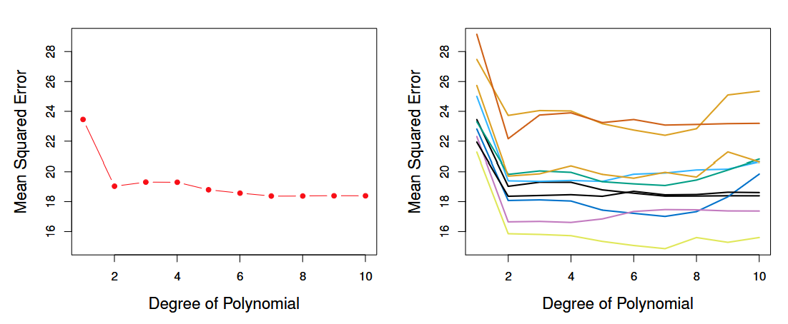
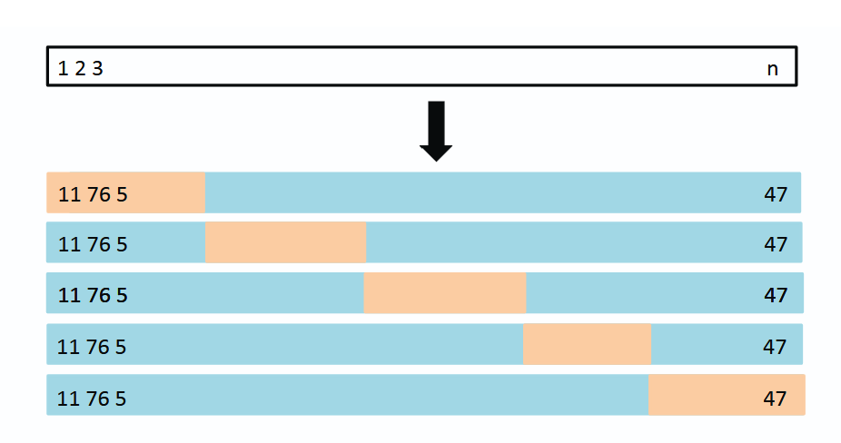

```{r, echo=FALSE, warning=FALSE, message=FALSE}
############ Set-Up ################
set.seed(2453)
library(ISLR2)
library(datasets)

auto <- ISLR2::Auto
?Auto
fit <- lm(mpg ~ horsepower, data = auto)
summary(fit)
plot(fit)
fit.2 <- lm(mpg ~horsepower^2, data=auto)

```

## Outline

1. The Validation Set Approach
2. Leave-One-Out Cross-Validation (LOOCV)
3. k-Fold Cross-Validation (k-fold CV)
4. Bias-Variance Trade-Off for k-fold Cross-Validation
5. Cross-Validation on Classification Problems
6. Worksheet

:::{.notes}
Hello, today we will be talking about chapter 5.1, which is about cross-validation methods. I'll be going over the validation set approach, leave-one-out cross-validation, k-fold cross-validation. After, Shrey will follow up with bias-variance trade-off in k-fold cross-validation, cross-validation on classification problems, and the worksheet.
:::

## Set-UP

- Auto dataset in ISLR library: gas mileage, horsepower, and 7 other variables for 392 vehicles.
- mpg: miles per gallon
- horsepower: engine horsepower
- lm(mpg ~ horsepower)
- lm(mpg~horsepower^2)

$$y_{mpg} = \beta_0 + \beta_{horsepower}x$$
$$y_{mpg} = \beta_0 + \beta_{horsepower}^2 x$$

```{r}

```


:::{.notes}
For the first three topics, we'll be using the Auto dataset from the ISLR library in R, which records 9 variables like miles per gallon, horsepower, weight, and year for 392 vehicles.  
:::

## The Problem

- We use all 392 observations to fit our model
- Chapter 2: Training error rate is available, but test error rate may not be available
- Is it ready to deploy in real life?
- What can we do without a test set?
- Cross-validation

:::{.notes}
In particular, we've fitted a linear model with miles per gallon as the response variable and horsepower as the predictor. We've used all 392 observations from our dataset, and our polynomial model is optimal. However, does this mean it's ready to be deployed in real life? Before we do that, we might want to test this model using test data and compare the training and test error rates, as seen in Chapter 2. However, what if we don't have a test dataset? How can we evaluate the model? We can use cross-validation comes in. Rather than finding a new dataset to test against, we can take our training data and split it in such a way that part of that becomes our test set. That is, we will hold out a subset of the data to test against.
:::

## Validation Set Approach

- One-time process where we divide the available dataset into 2 parts:
- Training set: Fit the model with this data
- Validation set/hold-out set: Test the fitted model. The model predicts responses for observations in the test set.
- Evaluate the MSE of the model against the test set $\rightarrow$ lower MSE = better. Get the test error rate.

{fig-alt="Dataset is split into training and hold-out sets. Observations 7, 22, and 13 are in the training set in blue; observation 91 is in the validation set"}

:::{.notes}
In the validation set approach, we randomly split the available data once into 2 sets: our training data, which we use to fit the model, and our test or hold-out dataset. A schematic is presented here, where blue indicates the training dataset and orange the testing dataset. We use our fitted model to predict the observations in the test dataset, then compare the error, or MSE to assess the accuracy of the model. We want to minimize the MSE.
:::

## Percentage of Training vs. Holdout Datasets

- In undergraduate courses, we were taught to split dataset 70/30 for training/testing, respectively
- 

:::{.notes}
In previous courses like STA302, we might have been taught to split the dataset such that 70% is used for training dataset for which the model is fitted against, and 30% of the data is for testing the model.
:::

## Comparison of Models MSEs

$ MSE = \sum_{i=1}^{n} (y_i - \hat{y}_i)$

Major Drawbacks:
1. Validation estimates of MSE can vary depending on which datapoints end up in the training vs. test sets

2. The full dataset is not used to fit the model, so validation set error rate my be overestimated for the model fit on the entire dataset.

{fig-alt="Estimating MSE from predicting mpg using polynomial functions of the predictor"}

:::{.notes}
However, there are two major drawbacks to this approach, which can be seen in Figure 2 below.  The first one is that the MSE can vary depending on how the data is split. The graph on the left shows MSE on the y-axis, and the x-axis shows the degree of the polynomial that was fitted and used against the test data set: for example, horsepower^2, cubed, etc., all the way until a power of 10. If we were to just follow the regular steps, where the data is split once, we might observe something like on the left, where polynomial of degree 2 decreases the MSE substantially and overall leads to better predictions, while higher polynomials don't necessarily improve the model accuracy by much.

However, if we were to repeat this process over and over again, splitting the dataset in randomly, repeating the fitting and testing process, we might get something like the graph on the right, where each line is a different iteration of this process. And while we're noticing similar trends in the polynomial with degree 2 functions lead to a relatively lower MSE, in absolute terms, some have much higher errors than other iterations. The dataset could be split in such a way that the training and testing sets look very different from each other, and impact the model's predictive accuracy.

The second concern is that the MSE might be overestimated. Splitting the dataset results in smaller datasets for the training and testing sets, which can inflate the error.

So overall, while it's one approach, it's not ideal. Are there other alternatives?
:::

## Leave-One-Out Cross-Validation

- Test set has 1 observation: $(x_1, y_1)$.
- Training set has $n-1$ observations: ${(x_2, y_2), (x_3, y_3),...,(x_n, y_n)}$
- $MSE_1 = (y_1 - \hat{y}_1)$
- Repeat $n$ times for $n$ MSEs.

$CV_{(n)} = \frac{1}{n} \sum_{i=1}^{n} MSE_{i}$

{fig-alt="Schematic"}

:::{.notes}
This is where leave-one-out cross-validation comes in. This time, we split the dataset such that the training set consists of n-1 observations, while the test set only has 1 observation. A schematic of what this might look like. We can then obtain the mean squared error for that one point, which in this case is x1, y1. Repeating this n times and taking their average, we'll obtain the LOOCV estimate for the test MSE. In each iteration, the test data point is not used in the fitting process, so we get an approximately unbiased test error estimate.
:::

## LOOCV advantages over Validation Set
- Less bias
- Less likely to overestimate the test error rate
- Performing LOOCV multiple times does not drastically change results

{fig-alt="Cross-Validation on Auto dataset"}

:::{.notes}
The biggest advantages to this approach compared to the validation set are that it reduces bias and it is less likely to overestimate the MSE since we're using n-1 observations or most of the dataset to fit the model. This can be seen in the figure below. The left graph shows what we might see if we were to just apply LOOCV. The right graph does multiple simulations of LOOCV, and unlike the validation method, we can see that even across different runs, the MSE does vary, but it's a lot less compared to the validation method.
:::

## However...
-LOOCV can be computationally expensive. The model must be fit $n$ times.
- Cost of LOOCV = single-model fit
$CV_{(n)} = \frac{1}{n} \sum_{i=1}^{n} \left( \frac{y_i - \hat{y_i}}{1-h_i} \right)$
- \hat{y}_i: ith fitted value from original least squares fit
- \hat{h}_i leverage defined in 3.37 in 99
- leverage lies between $\frac{1}{n}$ and 1, reflecting amount observation influences its own fit.
- good for any kind fo predictive modeling

:::{.notes}
The error rate here is similar to the ordinary MSE, but the ith residual is divided by 1-h. The residuals for high-leverage or highly influential points are inflated by the right amount and the equality holds. 5.2 cannot, however, be used for all types of predictive modelling, though LOOCV can be used for different types of predictive modelling.
:::

## k-fold Cross Validation

- Alternative to LOOCV is k-fold CV
- Randomly divide set of observations into "folds" of equal size. 
- The first told is treated as a validation set
- Statistical method is applied on remaining $k-1$ folds. 
- $MSE_1$ computed on observations on the held out fold.
- Repeat process k times
- Each time, different group of obs treated as validation set
- k estimates of test error
- average MSEs

$CV_{(k)} = \frac{1}{k} \sum_{i=1}^{k} MSE_{i}$

- LOOCV is special case of k-fold CV where k is set to equal n.
- Computational advantage

{fig-alt="k-fold Cross-Validation on Auto dataset. Observations 11, 76, and 5 in the first fold are used in the validation set, but later only in the training set. Observation 47 becomes part of the validation set in the fifth iteration."}

:::{.notes}
Another alternative to LOOCV is k-fold cross-validation. In this approach, we're dividing the set of observations into $k$ groups of $folds$, of approximately equal size. The first fold is treated as validation set, and the method is fit on the remaining $k-1$ folds or sets. The MSE is calculated based on the validation set, or the held-out fold. We repeat this process $k$ times, as seen in the figure below. We can also see how the LOOCV is basically a special case of k-fold CV, but we're using $n$ folds. K-fold CV is computationally less expensive in this regard. There's also bias-variance trade-off, which Shrey will be going over later.
:::

## Real vs. Simulated Data
- Use simulated data to see how well these methods capture the true MSE curves.
- In some cases, we may be more interested in the minimum point of the MSE curve.

{fig-alt="True and estimated test MSE for simulated datasets. True MSE is in blue, LOOCV estimate in black, and the k-fold CV where k=10 shown in orange"}

:::{.notes}
Now, when we work with real data, we don't know what the true MSE of the test set is. Therefore, it can be difficult to see how accurate each method is. Therefore, we might use simulated data and apply those techniques on simulated data to evaluate how accurate cross-validation methods are. In this the figure below, we've simulated data and plotted 
The true test MSE is displayed in blue, the black dash is the LOOCV and the orange is the 10-fold CV estimates.
:::

## What's Coming Next?
- Shrinkage methods


